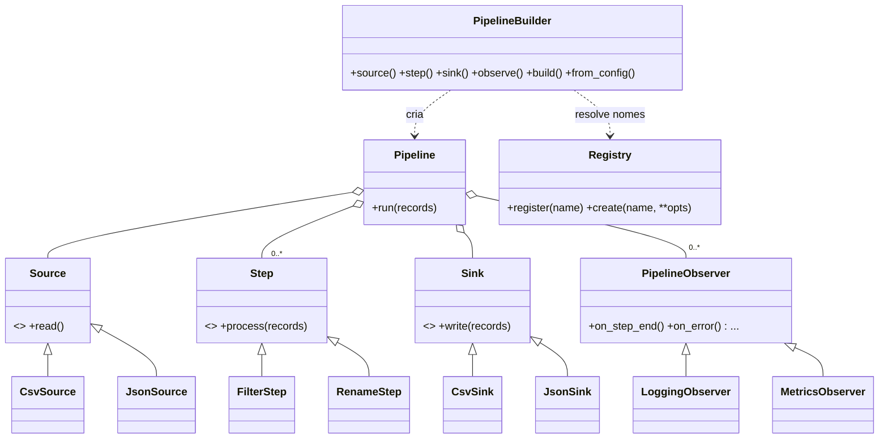

# DataFlow

Biblioteca Python **extensível** para construção e execução de pipelines de processamento de dados em memória.

Você descreve o fluxo **Source → Steps → Sink** e a DataFlow executa. Já vem com leitores, transformações e gravadores prontos, e você pode criar os seus próprios **sem alterar o código da biblioteca**.

## Equipe

- Leonardo Pereira
- Eduardo Erthal

## Vídeo de apresentação

https://youtu.be/qszAKusbWm4?is=a02ctpI9AVKq0QjS

## Problema que resolve

Scripts de tratamento de dados costumam virar um bloco único e rígido (ler → limpar → converter → salvar), difícil de reaproveitar e de testar. A DataFlow separa cada responsabilidade em uma etapa independente e reutilizável, e permite trocar origem, transformações e destino sem reescrever o fluxo.

## Instalação

Requer Python 3.10+ e não possui dependências externas.

```bash
git clone https://github.com/peratop/dataflow.git
cd dataflow
pip install -e ".[dev]"     # use "pip install ." se não for desenvolver
```

Rodar os testes:

```bash
pytest
```

## Uso rápido (componentes prontos)

```python
from dataflow import PipelineBuilder

pipeline = (
    PipelineBuilder("clientes-adultos")
    .source("csv", path="clientes.csv")
    .step("deduplicate")
    .step("cast", types={"id": int, "idade": int})
    .step("filter", predicate=lambda r: r["idade"] >= 18)
    .step("rename", mapping={"nome": "name"})
    .step("sort", key="name")
    .sink("json", path="saida.json")
    .build()
)

registros = pipeline.run()   # também devolve a lista final
```

Cada método do builder aceita **o nome registrado + opções** (como acima) **ou uma instância pronta**:

```python
from dataflow import CsvSource, FilterStep, PipelineBuilder

PipelineBuilder().source(CsvSource("clientes.csv")).step(FilterStep(lambda r: r["cidade"] == "Curitiba"))
```

Também é possível executar sobre dados já em memória, sem `source`:

```python
from dataflow import FilterStep, Pipeline

Pipeline(steps=[FilterStep(lambda r: r["ativo"])]).run([{"ativo": True}, {"ativo": False}])
```

### Configuração por dicionário

```python
config = {
    "name": "limpeza",
    "source": {"type": "csv", "path": "in.csv"},
    "steps": [
        {"type": "deduplicate"},
        {"type": "rename", "mapping": {"nome": "name"}},
    ],
    "sink": {"type": "json", "path": "out.json"},
}
PipelineBuilder.from_config(config).build().run()
```

### Acompanhando a execução

```python
import logging
from dataflow import LoggingObserver, MetricsObserver

logging.basicConfig(level=logging.INFO)
metrics = MetricsObserver()
pipeline = PipelineBuilder().source("csv", path="in.csv").observe(LoggingObserver()).observe(metrics).build()
pipeline.run()
print(metrics.steps, metrics.total_elapsed)
```

## Componentes incluídos

| Tipo | Nome | Descrição |
|---|---|---|
| Source | `csv` | CSV com cabeçalho (`path`, `delimiter`, `encoding`) |
| Source | `json` | JSON contendo uma lista de objetos |
| Source | `memory` | Lista de dicionários em memória |
| Step | `filter` | Mantém registros onde `predicate(registro)` é verdadeiro |
| Step | `map` | Aplica `func(registro) -> registro` |
| Step | `rename` | Renomeia campos (`mapping`) |
| Step | `select` / `drop` | Mantém / remove campos |
| Step | `cast` | Converte tipos (`types={"idade": int}`) |
| Step | `deduplicate` | Remove duplicados (`key_fields` opcional) |
| Step | `sort` | Ordena por campo ou função-chave |
| Sink | `csv` | Grava CSV |
| Sink | `json` | Grava lista JSON |
| Sink | `memory` | Guarda em `sink.records` |

Um registro é um `dict`; um conjunto de dados é uma `list[dict]`.

## Como estender (sem alterar a biblioteca)

Basta herdar de `Source`, `Step`, `Sink` ou `PipelineObserver`. Para usar o componente **pelo nome**, registre-o com o decorator:

```python
from dataflow import SOURCES, STEPS, Source, Step, PipelineBuilder
import xml.etree.ElementTree as ET

@SOURCES.register("xml")
class XmlSource(Source):
    def __init__(self, path):
        self._path = path

    def read(self):
        root = ET.parse(self._path).getroot()
        return [{c.tag: c.text for c in item} for item in root]

@STEPS.register("normalize_email")
class NormalizeEmailStep(Step):
    def process(self, records):
        return [{**r, "email": r["email"].strip().lower()} for r in records]

PipelineBuilder().source("xml", path="clientes.xml").step("normalize_email").build().run()
```

Regras para um `Step`: receber `list[dict]`, devolver `list[dict]` e **não mutar** a entrada.

Exemplos executáveis em [`examples/`](examples):

```bash
python examples/basic_usage.py
python examples/custom_extension.py
```

## Tratamento de erros

Falhas em qualquer etapa são convertidas em `StageExecutionError` (com `.stage` e `.original`), após notificar os observers via `on_error`. Outras exceções: `ConfigurationError`, `RegistryError` (todas herdam de `DataFlowError`).

## Arquitetura e padrões de projeto



| Padrão | Onde | Problema resolvido |
|---|---|---|
| **Strategy** | `core.py` (`Source`, `Step`, `Sink`) usadas por `pipeline.py` | O `Pipeline` não conhece formatos nem transformações concretas; algoritmos são intercambiáveis. |
| **Factory (baseada em Registry)** | `registry.py`, usado por `builder.py` | Criar componentes pelo nome e permitir que o cliente registre novos sem editar a lib (Open/Closed). |
| **Builder** | `builder.py` | Montar um pipeline com várias partes opcionais de forma fluente, validada e legível. |
| **Observer** | `observers.py`, disparado em `pipeline.py` | Logs e métricas sem acoplar o `Pipeline` a nenhuma dessas preocupações. |

### Estrutura do projeto

```
src/dataflow/
  core.py        # contratos Source / Step / Sink
  registry.py    # Registry + SOURCES / STEPS / SINKS
  sources.py     # csv, json, memory
  steps.py       # filter, map, rename, select, drop, cast, deduplicate, sort
  sinks.py       # csv, json, memory
  pipeline.py    # execução e notificação dos observers
  builder.py     # PipelineBuilder
  observers.py   # PipelineObserver, LoggingObserver, MetricsObserver
  errors.py
tests/           # pytest (inclui prova de extensibilidade)
examples/        # uso padrão e uso com extensão
```

## Licença

Veja o arquivo [LICENSE](LICENSE).
